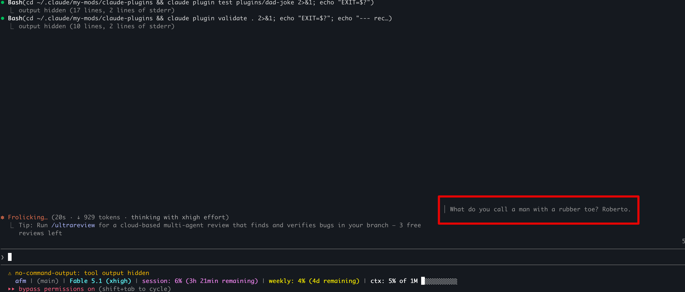

# dad-joke

A Claude Code mod: while Claude works, the spinner row is split in two, the
engine's own line on the left and a dad joke on the right. The joke changes
every minute. Between turns there is no joke.

```
· Hullaballooing… (2m 41s · ↓ 3.8k tokens · deep in thought)   │ I'm reading a book about
                                                                 │ anti-gravity. It's impossible
                                                                 │ to put down.
```



- The left side is exactly what Claude Code draws without the mod (the
  animated word, elapsed time, tokens, effort); the mod only adds the right
  column. On a terminal narrower than 90 columns the joke goes under the line
  instead.
- Jokes come from the plugin's own `jokes/dad_jokes.json`, one list per
  language (`en`, `es`). It ships with 115 English and 122 Spanish jokes.
- `/dad-joke-now` tells one right away, mid-turn or idle. `/dad-joke off`
  hides the panel for the session, `/dad-joke on` brings it back.
- `/dad-joke-add-joke <joke>` stores one you came across, in the language it
  reads as, for the future.
- `/dad-joke-more-jokes` asks Claude to search the web for at least 50 new
  jokes in the configured language and add them to the file.

## Install

From the prompt of a terminal session:

```
/plugin install dad-joke --marketplace marcoscano/claude-plugins
```

Answer `y` to add the marketplace, pick the user scope, and accept or change
the options. The plugin is active in that session and in every session after.

To run it from a checkout instead, for one session:

```
claude --plugin-dir /path/to/claude-plugins/plugins/dad-joke
```

or in every session through the `env` block of `~/.claude/settings.json`
(several folders are separated with `:`):

```json
{
  "env": {
    "CLAUDE_CODE_PLUGIN_DIRS": "/path/to/claude-plugins/plugins/dad-joke"
  }
}
```

## Usage

| Command | Effect |
| --- | --- |
| `/dad-joke` | Toggle the joke panel for the session |
| `/dad-joke on` / `/dad-joke off` | Show or hide it |
| `/dad-joke-now` | Print a joke in the transcript now |
| `/dad-joke-add-joke [en:\|es:] <joke>` | Store one joke in the file, quotes optional |
| `/dad-joke-more-jokes` | Have Claude search the web for 50 new jokes and add them |

## Options

Both are rows under `/config`, or `pluginConfigs.dad-joke.options` in
`~/.claude/settings.json`:

| Option | Values | Default | What it does |
| --- | --- | --- | --- |
| `language` | `all`, `en`, `es` | `all` | Which jokes to tell, and which language `/dad-joke-more-jokes` collects |
| `enabledByDefault` | `true`, `false` | `true` | Whether a session starts with the panel on; `/dad-joke on\|off` overrides it for the session |

## Growing the collection

One at a time, as you come across them:

```
/dad-joke-add-joke "¿Por qué el marisco viene del mar? Porque si viniera de Francia se llamaría Francisco"
```

The joke goes to the list of the language it reads as (accents, `¿`, `ñ` and
stop words decide; a tie falls back to the configured language). Prefix it
with `en:` or `es:` to choose; with `all` configured and no clear reading,
the command asks for that prefix. A joke already held, compared without case
or punctuation, is reported and not added twice. Telling Claude "store this
joke: ..." works as well: it calls the same `add_jokes` tool described below.

In bulk, `/dad-joke-more-jokes` submits a prompt to Claude (a turn of its own, once
the session is idle) listing the jokes already held and asking for at least
50 new ones in the configured language, found through web search. The mod
registers one tool for Claude to hand them back with, `add_jokes`
(`mcp__dad-joke__add_jokes`, `{ language, jokes }`), which drops duplicates
(compared without case or punctuation), appends the rest to
`jokes/dad_jokes.json` and reports the count, so Claude keeps searching until
50 are in. The new jokes are on hand right away.

The file written is the one inside the plugin folder that is running:

- From a checkout (`--plugin-dir`), that is the repository's file, so the
  additions can be committed and shipped.
- From a marketplace install, that is the copy under
  `~/.claude/plugins/cache/`, which an update of the plugin replaces with the
  shipped file.

Edit the file by hand if you like: `{ "en": [...], "es": [...] }`, one string
per joke. It is read at session start.

## How it works

One hooks module, `hooks/register.tsx`:

- `session.start` reads the jokes file, registers the three commands and the
  `add_jokes` tool, and starts a five-second timer that rotates the joke once
  the one on show is a minute old. The timer does nothing while no turn runs.
- `turn.start` on the main loop (a subagent's turn is ignored) picks a joke
  into `$.state`; `turn.complete` clears it.
- `ui.render` on the `Spinner` component reads that value (which subscribes
  the row, so each new joke redraws it) and, when there is one, nests the
  engine's own drawing of the spinner (`next(e)`) in the left column of a row
  and the joke in the right.
- The commands answer `command.run`; `/dad-joke-more-jokes` submits its prompt
  from a zero-delay timer, because a prompt submitted inside a command's own
  dispatch is refused by the engine.
- `/dad-joke-add-joke` and the `tool.call` hook on `mcp__dad-joke__add_jokes`
  share one function that drops duplicates, appends to the list, writes the
  file with `$.fs.write` and reports the counts. The list is updated before
  the write, so two adds that overlap both end up in the file.

State is declared in `types/index.d.ts`: `current` (the joke on show, or
null) and `isEnabled` (the session's switch).

## Development

```
claude plugin validate .
claude plugin test .
```

Once a session has loaded the mod, Claude Code writes its API types to
`.claude-plugin/types/` (ignored by git), and `tsc -p .` type-checks it.

Notes for changes:

- Reach `$.state` directly (`$.state.get`, `$.state.set`), and pass `$` only
  to functions declared at the top of `register.tsx`: the loader follows `$`
  nowhere else.
- Declare every `$.state` key in `types/index.d.ts`; `claude plugin validate`
  holds the module to that contract.
- Add or adjust a test in `tests/` for the behaviour you change.

Written against Claude Code 2.1.304. The function-hooks API is early access
and may change between releases.

## License

MIT, see the repository's `LICENSE`.
